# 🏦 Mini Bank Management System API

<p align="center">
  
  
  
  
  
  
</p>

<p align="center">
  <b>A robust, secure, and production-grade RESTful Banking Backend built with Django and Django REST Framework.</b><br>
  Featuring ACID-compliant atomic transactions, row-level database locking to eliminate race conditions, cryptographic 10-digit account generation, granular filtering, and role-based administrative control.
</p>

<p align="center">
  <a href="#-key-features">Key Features</a> •
  <a href="#-system-architecture">System Architecture</a> •
  <a href="#-api-endpoints-reference">API Endpoints</a> •
  <a href="#-interactive-api-walkthrough--demo">Screenshots Walkthrough</a> •
  <a href="#-installation--setup">Getting Started</a> •
  <a href="#-security--financial-integrity">Security</a>
</p>

---

## 🌟 Key Features

- **🔐 Token-Based Authentication**: Secure stateless token authentication for user registration, login, and profile operations.
- **🏦 Automated Account Generation**: Secure 10-digit unique bank account generation powered by Python's `secrets` module.
- **💼 Multi-Account Flexibility**: Complete lifecycle management for both `SAVINGS` and `CURRENT` accounts.
- **⚡ ACID-Compliant Financial Operations**:
  - **Deposit**: Instant balance crediting with detailed ledger audit trails.
  - **Withdrawal**: Comprehensive balance and validation checks (`amount >= 0.01`, insufficient balance prevention).
  - **Fund Transfer**: Peer-to-peer account transfers executed within atomic database transactions with row-level locking (`select_for_update()`).
- **🔍 Advanced Transaction Filtering**:
  - Filter by **Transaction Type** (`DEPOSIT`, `WITHDRAWAL`, `TRANSFER_IN`, `TRANSFER_OUT`).
  - Filter by custom **Date Range** (`start_date` and `end_date`).
  - Built-in pagination (`PageNumberPagination`).
- **🛡️ Administrative Governance**: Privileged endpoints for staff users to oversee customer listings, all system accounts, and sitewide transaction logs.

---

## 🏛️ System Architecture

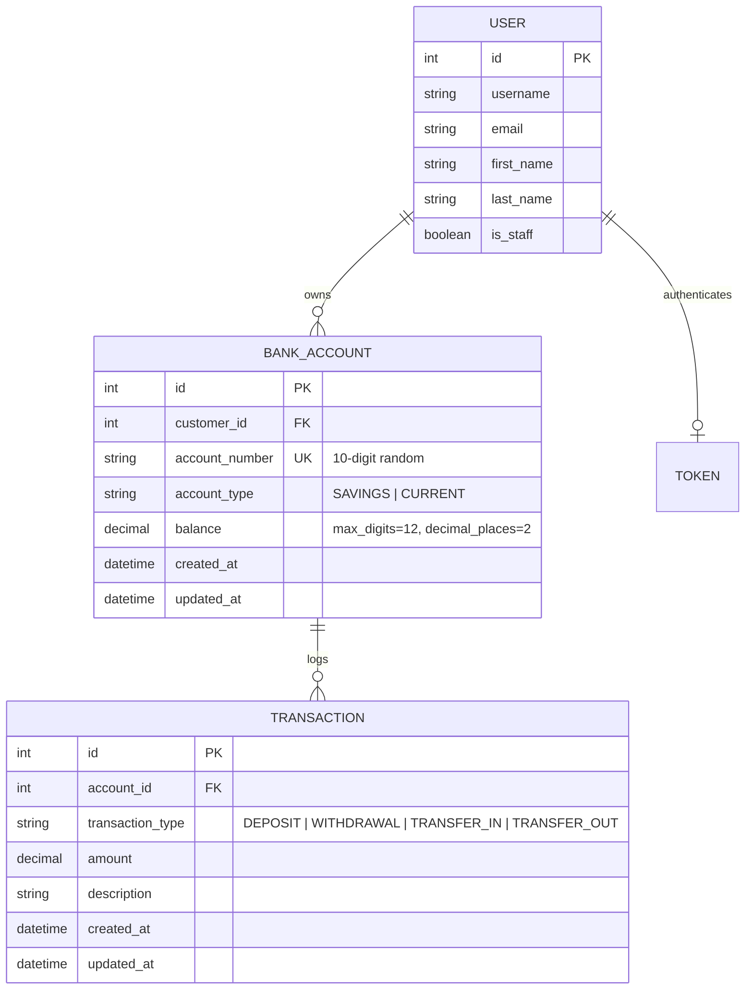

---

## 📋 API Endpoints Reference

### 🔐 Authentication (`/api/auth/`)
| Method | Endpoint | Access Level | Description |
| :--- | :--- | :--- | :--- |
| `POST` | `/api/auth/register/` | Public | Register new customer account |
| `POST` | `/api/auth/login/` | Public | Authenticate user & generate token |
| `GET` | `/api/auth/profile/` | Authenticated | Retrieve authenticated user profile |
| `PATCH` | `/api/auth/profile/` | Authenticated | Update user profile details |

### 💳 Accounts & Banking Operations (`/api/accounts/`)
| Method | Endpoint | Access Level | Description |
| :--- | :--- | :--- | :--- |
| `GET` | `/api/accounts/` | Authenticated | List all accounts owned by user |
| `POST` | `/api/accounts/` | Authenticated | Open a new bank account (`SAVINGS`/`CURRENT`) |
| `GET` | `/api/accounts/<id>/` | Authenticated | View specific account details |
| `GET` | `/api/accounts/<id>/balance/` | Authenticated | Fast balance check |
| `POST` | `/api/accounts/<id>/deposit/` | Authenticated | Deposit money into account |
| `POST` | `/api/accounts/<id>/withdraw/` | Authenticated | Withdraw money with validation checks |
| `POST` | `/api/accounts/<id>/transfer/` | Authenticated | Atomic transfer to another account |
| `GET` | `/api/accounts/<id>/transactions/` | Authenticated | Paginated transaction history with filters |

### 🛡️ Admin Dashboard (`/api/admin/`)
| Method | Endpoint | Access Level | Description |
| :--- | :--- | :--- | :--- |
| `GET` | `/api/admin/customers/` | Admin Only | List all registered customers |
| `GET` | `/api/admin/accounts/` | Admin Only | View all system bank accounts & balances |
| `GET` | `/api/admin/transactions/` | Admin Only | Full audit log of all system transactions |

---

## 📸 Interactive API Walkthrough & Demo

<details open>
<summary><b>🔐 1. Authentication & Profile Management</b></summary>
<br>

<table>
  <tr>
    <td width="50%" align="center">
      <b>01. User Registration (`POST /api/auth/register/`)</b><br>
      <sub>Creates a new customer profile and returns 201 Created</sub><br><br>
      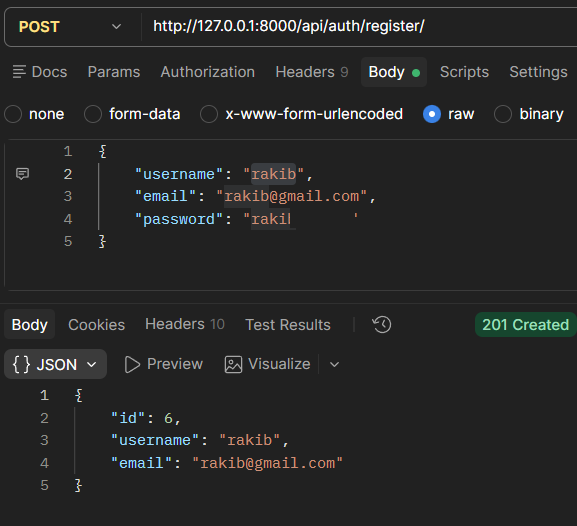
    </td>
    <td width="50%" align="center">
      <b>02. User Login (`POST /api/auth/login/`)</b><br>
      <sub>Authenticates credentials and returns a secure auth token</sub><br><br>
      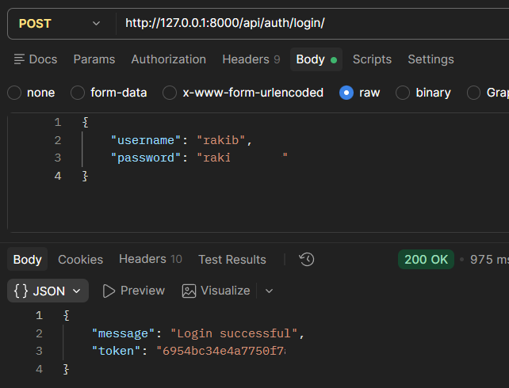
    </td>
  </tr>
  <tr>
    <td width="50%" align="center">
      <b>03. View Profile (`GET /api/auth/profile/`)</b><br>
      <sub>Retrieves current user details using Token header</sub><br><br>
      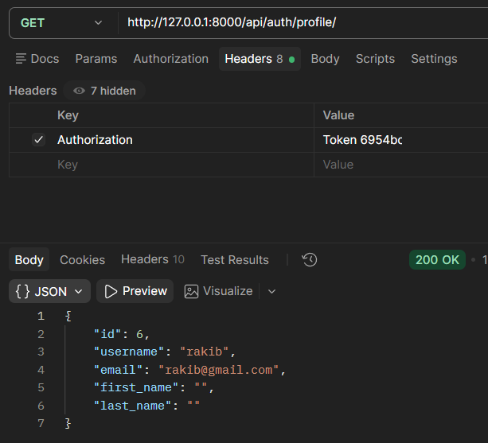
    </td>
    <td width="50%" align="center">
      <b>04. Update Profile (`PATCH /api/auth/profile/`)</b><br>
      <sub>Updates first name, last name, or email smoothly</sub><br><br>
      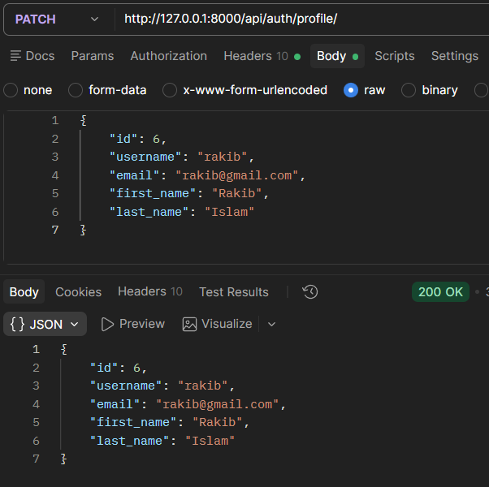
    </td>
  </tr>
</table>

</details>

<br>

<details open>
<summary><b>💳 2. Account Creation & Detail Inquiries</b></summary>
<br>

<table>
  <tr>
    <td width="50%" align="center">
      <b>05. Create Bank Account (`POST /api/accounts/`)</b><br>
      <sub>Generates a unique 10-digit account number automatically</sub><br><br>
      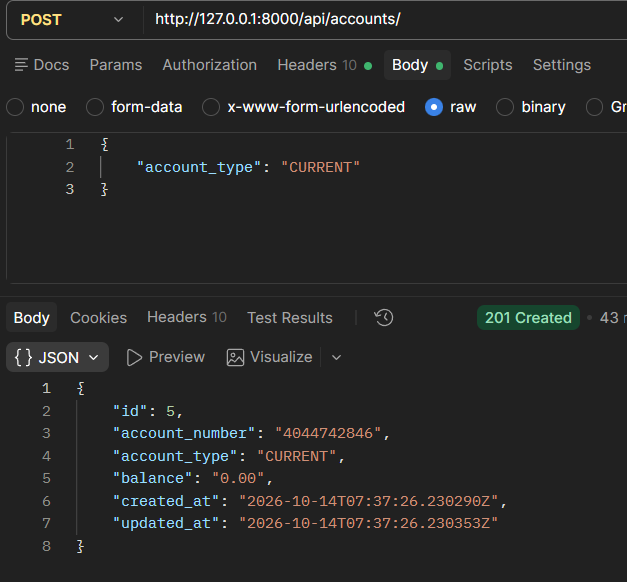
    </td>
    <td width="50%" align="center">
      <b>06. Account Details (`GET /api/accounts/<id>/`)</b><br>
      <sub>Fetches real-time account status, balance, and type</sub><br><br>
      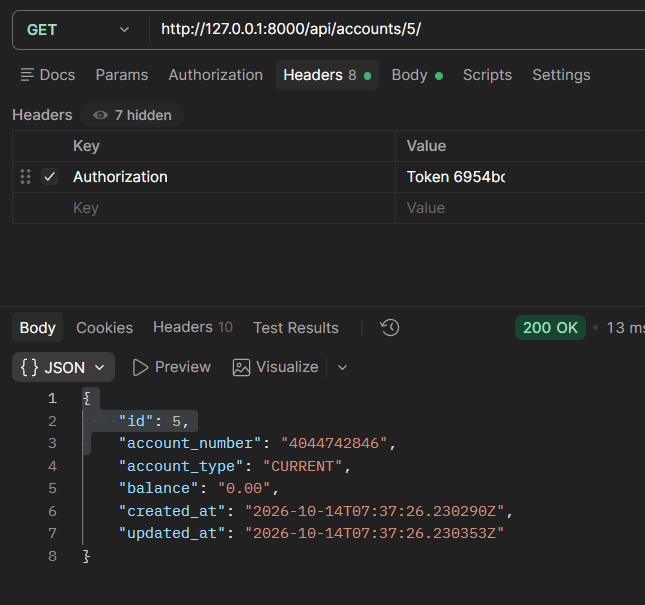
    </td>
  </tr>
</table>

</details>

<br>

<details open>
<summary><b>💸 3. Deposits, Withdrawals & Fund Transfers</b></summary>
<br>

<table>
  <tr>
    <td width="50%" align="center">
      <b>07. Deposit Funds (`POST /api/accounts/<id>/deposit/`)</b><br>
      <sub>Credits amount and logs a DEPOSIT transaction record</sub><br><br>
      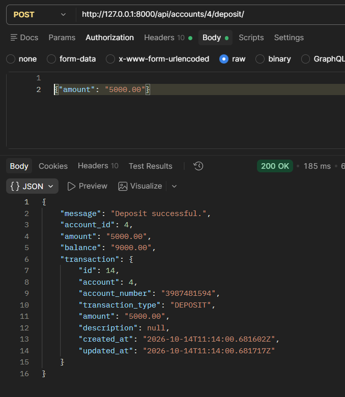
    </td>
    <td width="50%" align="center">
      <b>08. Withdrawal Validation Error (`POST .../withdraw/`)</b><br>
      <sub>Validation check rejects negative or sub-minimum inputs</sub><br><br>
      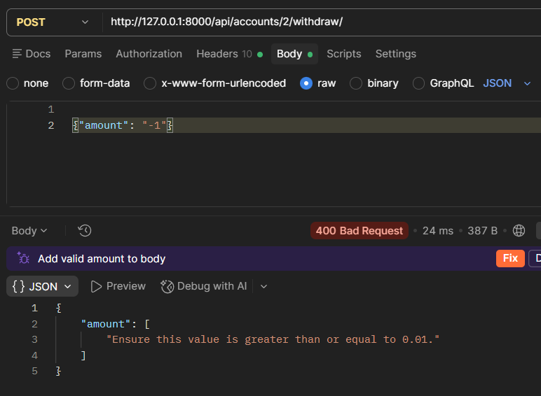
    </td>
  </tr>
  <tr>
    <td width="50%" align="center">
      <b>09. Successful Withdrawal (`POST .../withdraw/`)</b><br>
      <sub>Debits balance safely with row locking & logs transaction</sub><br><br>
      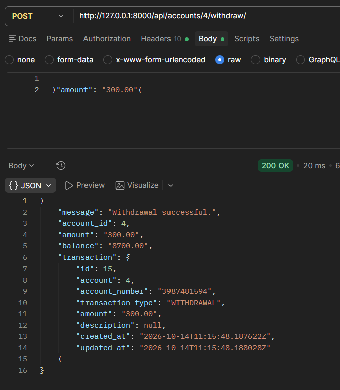
    </td>
    <td width="50%" align="center">
      <b>12. Peer-to-Peer Transfer (`POST .../transfer/`)</b><br>
      <sub>Atomic fund transfer debiting sender & crediting receiver</sub><br><br>
      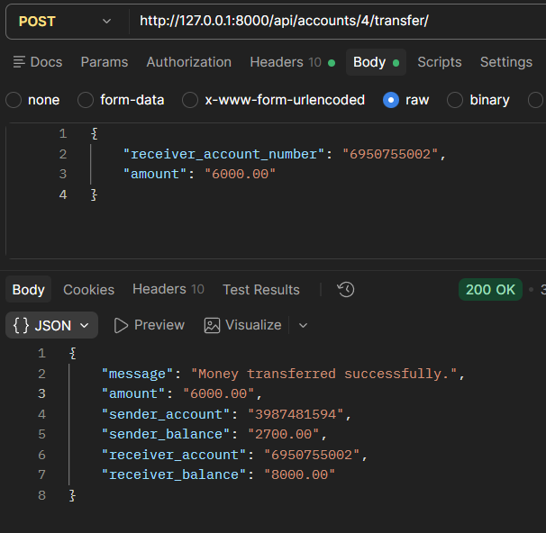
    </td>
  </tr>
</table>

</details>

<br>

<details open>
<summary><b>📊 4. Transaction Ledger & Advanced Filtering</b></summary>
<br>

<table>
  <tr>
    <td width="50%" align="center">
      <b>10. Paginated Transaction History (`GET .../transactions/`)</b><br>
      <sub>Displays full ledger with pagination support</sub><br><br>
      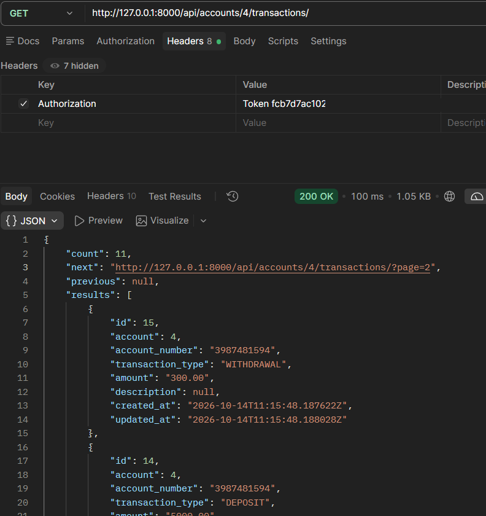
    </td>
    <td width="50%" align="center">
      <b>11. Filter by Type (`?transaction_type=WITHDRAWAL`)</b><br>
      <sub>Filters ledger strictly by transaction category</sub><br><br>
      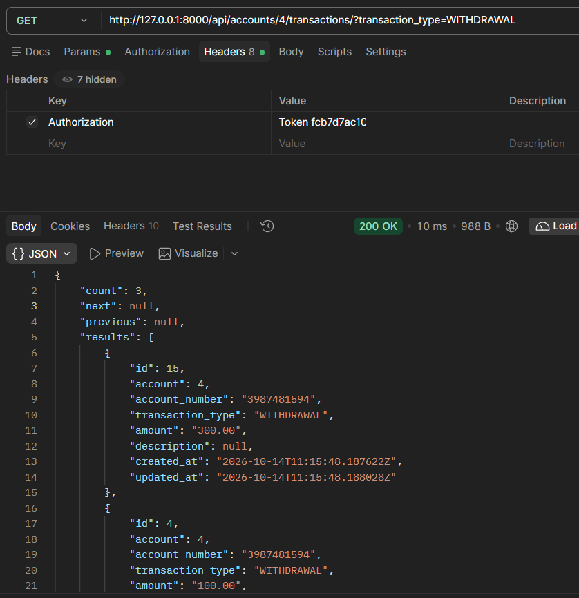
    </td>
  </tr>
</table>

<p align="center">
  <b>15. Filter by Date Range (`?start_date=2026-10-01&end_date=2026-10-14`)</b><br>
  <sub>Retrieves all debit and credit movements within custom time periods</sub><br><br>
  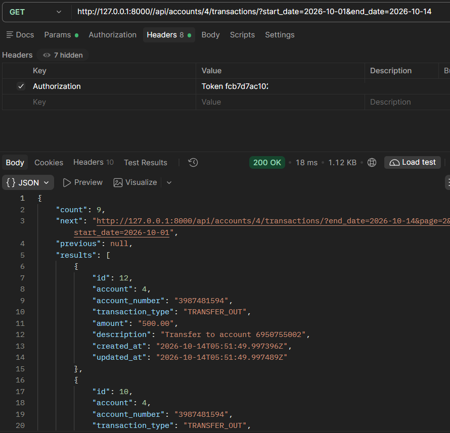
</p>

</details>

<br>

<details open>
<summary><b>🛡️ 5. Administrative Oversight & Auditing</b></summary>
<br>

<table>
  <tr>
    <td width="50%" align="center">
      <b>13. Customer Directory (`GET /api/admin/customers/`)</b><br>
      <sub>Admin view of registered users and join timestamps</sub><br><br>
      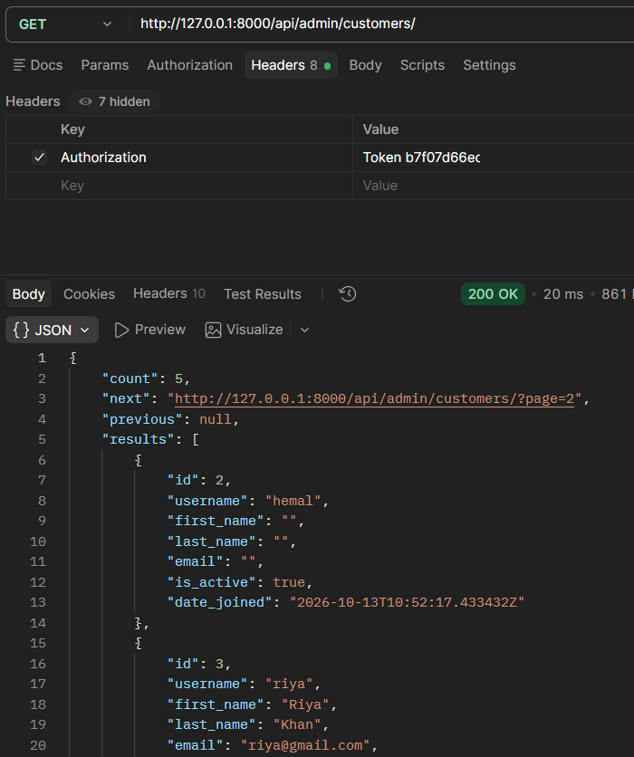
    </td>
    <td width="50%" align="center">
      <b>14. System Accounts Overview (`GET /api/admin/accounts/`)</b><br>
      <sub>Master view of all bank accounts across all clients</sub><br><br>
      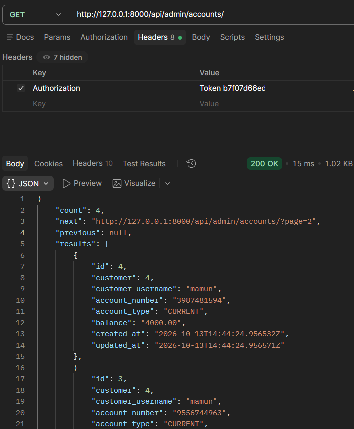
    </td>
  </tr>
</table>

</details>

---

## 🛠️ Installation & Setup

### 1. Clone Repository & Setup Virtual Environment
```bash
# Clone the project repository
git clone https://github.com/AbdullahNoman-01/Mini-Bank-Management-System-API.git
cd Mini-Bank-Management-System-API

# Create and activate virtual environment
python -m venv venv

# Windows (Command Prompt / PowerShell)
venv\Scripts\activate

# Linux / macOS
source venv/bin/activate
```

### 2. Install Dependencies
```bash
pip install django djangorestframework django-filter
```

### 3. Configure Database & Migrations
```bash
# Apply migrations
python manage.py makemigrations
python manage.py migrate

# Create superuser for admin endpoints
python manage.py createsuperuser
```

### 4. Run Development Server
```bash
python manage.py runserver
```
The server will start at `http://127.0.0.1:8000/`.

---

## 🔒 Security & Financial Integrity

1. **Atomic Operations (`transaction.atomic`)**:
   Money movements (Deposit, Withdraw, Transfer) run inside atomic blocks. If any operation fails, the entire transaction rolls back cleanly without inconsistent states.
2. **Row-Level Locking (`select_for_update`)**:
   Prevents race conditions by locking the target account rows during balance mutations until the database transaction is committed.
3. **Decimal Precision**:
   Balances and amounts are strictly stored as `DecimalField(max_digits=12, decimal_places=2)` to prevent floating-point rounding errors in monetary values.
4. **Data Isolation**:
   Customers can only access and perform actions on accounts they own (`customer=request.user`), with staff endpoints restricted via `IsAdminUser`.

---

## 📬 Quick cURL Test Examples

#### Login & Acquire Token
```bash
curl -X POST http://127.0.0.1:8000/api/auth/login/ \
  -H "Content-Type: application/json" \
  -d '{"username": "rakib", "password": "your_password"}'
```

#### Transfer Money
```bash
curl -X POST http://127.0.0.1:8000/api/accounts/4/transfer/ \
  -H "Authorization: Token <your_auth_token>" \
  -H "Content-Type: application/json" \
  -d '{"receiver_account_number": "6950755002", "amount": "500.00"}'
```

---

## 📄 License & Author

Distributed under the **MIT License**. See `LICENSE` for more information.

Developed with ❤️ by **[Abdullah Noman](https://github.com/AbdullahNoman-01)**.
